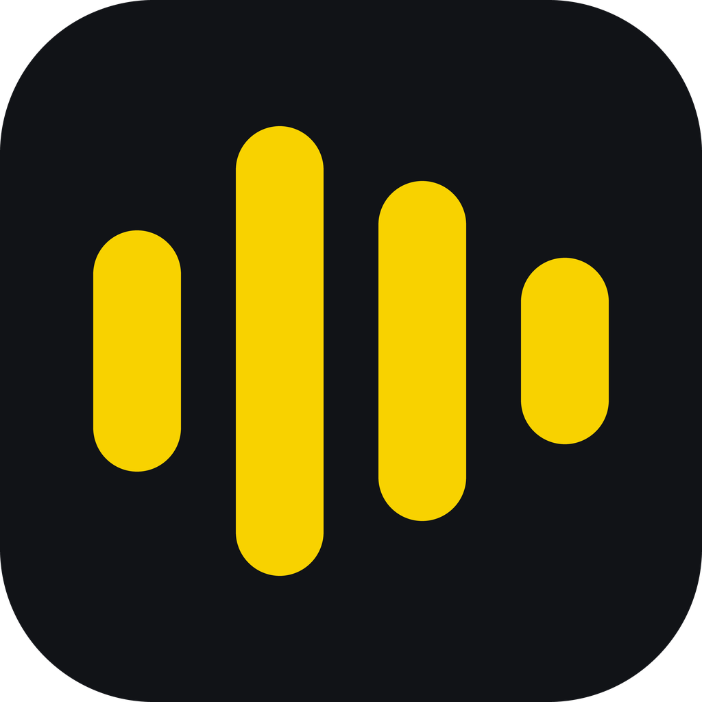
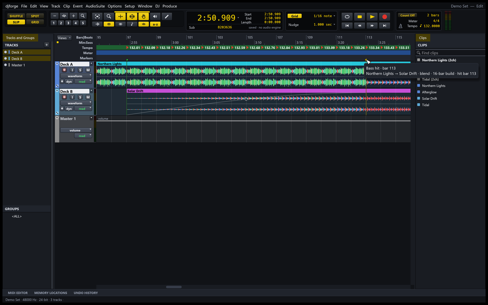
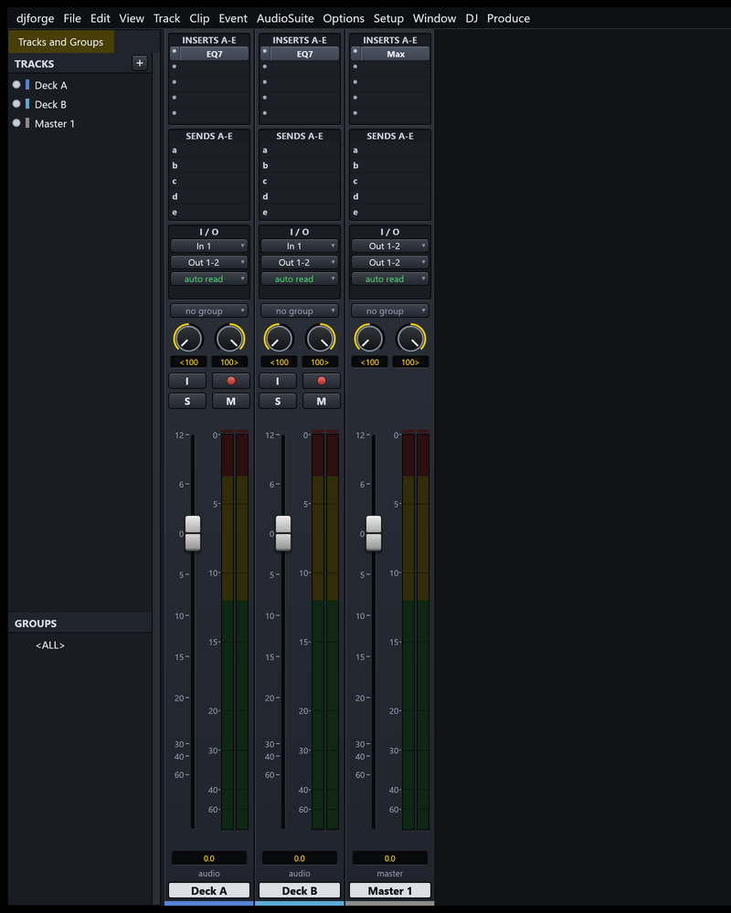

<p align="center">
  
</p>

<h1 align="center">djforge</h1>

<p align="center">
  <b>A DJ-first DAW: build, prep and play DJ sets with a full multitrack editor and mixer underneath.</b>
</p>

<p align="center">
  djforge is a fork of <a href="https://github.com/storytold/soundcraft">SoundCraft</a>, the open-source,
  pure-Rust digital audio workstation by the <a href="https://getartcraft.com/">ArtCraft</a> team. It keeps
  SoundCraft's Edit and Mix windows, plugins, automation, MIDI and recording, and adds what a DJ needs on
  top: set import from mixforge plans, beat-locked transitions, track prep, stems, Session view slots to
  jam with, and exports to Rekordbox and Mixxx. Everything stays scriptable from the command line or by
  an AI agent.
</p>

<p align="center">
  
  
  
</p>

> [!NOTE]
> **Based on SoundCraft.** djforge is built on SoundCraft by the ArtCraft team, dual-licensed
> MIT OR Apache-2.0; its licence and credit notices are kept in [LICENSE-MIT](LICENSE-MIT),
> [LICENSE-APACHE](LICENSE-APACHE), [NOTICE](NOTICE) and [ATTRIBUTION.md](ATTRIBUTION.md). Most of
> what this page describes is SoundCraft's work. djforge saves sessions as `.djforge` files and still
> opens SoundCraft's `.scraft` sessions (it never writes over them). The apps are `djforge` and
> `djforge-cli`.

<p align="center">
  
  <br>
  <sub>The Edit window: tracks, waveforms, MIDI, rulers, markers and the transport, playing the built-in demo song (every sound in it is synthesised by the app itself).</sub>
</p>

<p align="center">
  <a href="#what-it-does">What it does</a> ·
  <a href="#getting-started">Getting started</a> ·
  <a href="#for-agents-and-scripts">Agents &amp; scripts</a> ·
  <a href="#how-its-built">How it's built</a> ·
  <a href="#status-and-roadmap">Status</a> ·
  <a href="#downloads">Downloads</a> ·
  <a href="#based-on-soundcraft">Based on SoundCraft</a> ·
  <a href="#license-and-credits">License</a>
</p>

## What it does

Under the DJ features, djforge follows the workflow audio engineers already know (from SoundCraft): an **Edit window** for arranging and
editing, a **Mix window** for balancing, edit modes, tools, playlists, memory locations, AudioSuite
processing and the rest. If you've spent years in that workflow, your hands should already know
where things are.

<table>
  <tr>
    <td width="50%"></td>
    <td width="50%"></td>
  </tr>
  <tr>
    <td><b>Mix window.</b> Ten inserts and ten sends per track, busses and aux inputs, master faders, VCAs, routing folders, solo-in-place with implicit solo, and meters with peak hold.</td>
    <td><b>MIDI editor.</b> Instrument tracks with built-in synths, a piano roll with a velocity lane, step input, quantize, transpose, and Standard MIDI File import and export.</td>
  </tr>
  <tr>
    <td width="50%"></td>
    <td width="50%"></td>
  </tr>
  <tr>
    <td><b>Automation and markers.</b> Breakpoint automation for volume, pan, mute, sends and every plugin parameter, written live in Write, Touch and Latch, plus memory locations and a big counter.</td>
    <td><b>Everywhere.</b> Signed builds for macOS (universal), Windows (x64, x86, Arm), Linux (AppImage, deb, rpm, Flatpak), FreeBSD, and a WebAssembly build that runs in the browser.</td>
  </tr>
  <tr>
    <td width="50%"></td>
    <td width="50%"></td>
  </tr>
  <tr>
    <td><b>Video.</b> A picture track with thumbnails and a Video window that follows the playhead, decoding H.264, ProRes and Motion JPEG in pure Rust, with timecode burn-in and sync offset.</td>
    <td><b>Surround and immersive.</b> Main and bus formats from stereo to 9.1.6 and Ambisonics, a surround panner with divergence and height, object/bed routing and a Renderer window with live speaker levels.</td>
  </tr>
  <tr>
    <td width="50%"></td>
    <td></td>
  </tr>
  <tr>
    <td><b>Notation.</b> A Score Editor for MIDI tracks, MusicXML export for Sibelius and other notation programs, and printable engraved scores.</td>
    <td><b>Your plugins too.</b> CLAP, VST3 and Audio Units, with their own editors, their state saved in the session, and every instance created off the audio thread.</td>
  </tr>
</table>

### Feature tour

- **Editing:** Shuffle, Slip, Spot and Grid modes; Smart, Selector, Grabber, Trim, Pencil, Zoom and
  Scrubber tools; cut, copy, paste, duplicate, repeat, shift, insert silence, separate (at
  selection, on grid, at transients), heal, consolidate, strip silence, nudge; fades and
  crossfades in five shapes, drawn straight from the clip corners; playlists with comping lanes;
  clip gain lines; edit groups; single-key Commands Focus shortcuts; trackpad scrolling that
  follows your fingers and pinch-to-zoom around the pointer; undo for everything.
- **Mixing:** fader and pan with automation, pre/post sends, busses, aux inputs, master faders,
  VCA masters, routing folders, solo modes, mute and solo groups, phase invert and trim, clip
  effects, and automatic plugin delay compensation.
- **Automation:** volume, pan, mute, send and every plugin parameter; Write, Touch, Latch and
  Trim passes recorded live from the faders; thin, glide, coalesce and convert to clip gain.
- **Plugins:** 7-band and 1-band EQ, compressor/limiter, expander/gate, de-esser, maximizer,
  channel strip, room and plate reverbs, mod delay, chorus, flanger, phaser, saturator, lo-fi,
  rectifier, pitch shifter, time shift, gain, trim, invert, DC removal, signal generator, dither,
  a subtractive synth, a drum synth and a sampler (plays any WAV, AIFF, FLAC, MP3 or OGG across the
  keyboard), all original. **CLAP plugins** load too. Any processor
  runs offline as AudioSuite, and user presets save per plugin.
- **MIDI:** instrument and MIDI tracks, a piano-roll MIDI editor with a velocity lane, an event
  list, a score view, step input, quantize, transpose, real-time properties, Standard MIDI Files,
  and Audio-to-MIDI from a sung or played melody.
- **Recording:** punch in on a selection or on the fly, pre/post-roll, loop recording with a
  playlist per take, input monitoring through the full channel strip, and autosave with recovery.
- **Time and tempo:** Bars|Beats, Min:Secs, Timecode (every rate, drop-frame included),
  Feet+Frames and Samples; tempo and meter maps with a tempo editor; linear, parabolic and
  S-curve tempo ramps; key signatures and detected chords; Beat Detective and Identify Beat;
  pitch-preserving Elastic warping.
- **Audio files:** WAV/BWF/RF64, AIFF/AIFC and FLAC in and out; MP3, Ogg Vorbis, AAC, ALAC, CAF
  and the audio of MP4/MOV movies in. Any sample rate and bit depth.
- **Bounce:** mix or stems to WAV, AIFF or FLAC at 16/24/32-bit float with dither and
  normalisation, reporting peak, true peak and integrated loudness (LUFS).
- **Fast:** a parallel mix engine, copy-on-write undo, and a UI that holds 120 frames per second
  with seventy-odd tracks playing.

## Getting started

Download a build from the [releases page](https://github.com/storytold/soundcraft/releases), or build
from source with Rust 1.95 or later for the desktop/web UI (the core workspace's declared
minimum remains Rust 1.90):

```sh
git clone https://github.com/storytold/soundcraft
cd soundcraft
cargo run --release -p soundcraft -- --demo     # opens the demo song (the binary is djforge)
```

Linux needs the ALSA headers (`libasound2-dev` on Debian/Ubuntu, `alsa-lib-devel` on Fedora).

The web build:

```sh
cd apps/soundcraft-web && trunk serve --release   # then open http://127.0.0.1:8080
```

Useful shortcuts: <kbd>Space</kbd> play/stop, <kbd>⌘</kbd><kbd>=</kbd> Mix/Edit,
<kbd>F1</kbd>–<kbd>F4</kbd> edit modes, <kbd>F5</kbd>–<kbd>F10</kbd> tools, <kbd>⌘</kbd><kbd>E</kbd>
separate, <kbd>⌘</kbd><kbd>D</kbd> duplicate, <kbd>Enter</kbd> new marker, <kbd>⌘</kbd><kbd>⇧</kbd><kbd>N</kbd>
new tracks. **Setup › Keyboard Shortcuts** lists them all.

### Logs

The desktop app writes its `log` records to standard error and to `logs/djforge.log` in the
settings directory, beside `ui.json`, `Autosave/` and `Presets/` (Linux `~/.config/djforge/logs/`,
or `$XDG_CONFIG_HOME/djforge/logs/`; macOS `~/Library/Application Support/djforge/logs/`;
Windows `%APPDATA%\djforge\logs\`). On its first run djforge copies an existing SoundCraft
settings folder (`%APPDATA%\SoundCraft` and the like) into its own once, leaving the old one as it was. A start from a desktop menu or the Dock has no terminal, so
this file is what to attach to a bug report: the engine's panic report, audio devices that failed to
open or broke, plugins that refused their stored state, CLAP plugins' own messages and files that
failed to open land there. Each launch moves the previous log to `djforge.1.log` (and that one to
`djforge.2.log`), so the log of a run that crashed survives the next start. The file stops
growing at 16 MiB. `--version` writes no file, and runs with `SOUNDCRAFT_NO_PREFS` log to standard
error only.

| Variable | Effect |
|---|---|
| `RUST_LOG` | Log levels for standard error and the log file. Default: `info` for the app's own crates, `warn` for everything else. env_logger-style directives replace that, e.g. `RUST_LOG=debug`, `RUST_LOG=warn,soundcraft_mix=trace` or `RUST_LOG=info,wgpu_core=warn`; a directive ending in `*` covers every target starting with it (`soundcraft*=debug`). |
| `SOUNDCRAFT_NO_PREFS` | No preferences read or written and no log file (agents' test runs). |

The realtime audio thread never writes a record itself: the logger keeps the first one it logs
(without waiting or allocating), counts the rest, and the UI thread writes them. The logger is
`apps/soundcraft/src/logging.rs`. The web app logs to the browser console instead.

## For agents and scripts

Everything you can click is also a command with an id and JSON parameters, and the same commands
are reachable from the menus, the keyboard, the command line, a JSON control channel and an
[MCP](https://modelcontextprotocol.io) server. Programmatic calls never open dialogs, and
`session.inspect` reports exactly what changed, so an agent can check its own work.

```sh
# Headless: load the demo, turn the kick down, add an EQ, bounce.
djforge-cli run --demo \
  --cmd 'mix.volume={"track":"Kick","db":-6}' \
  --cmd 'mix.insert={"track":"Bass","plugin":"eq_7band"}' \
  --bounce mix.wav

# Drive the running app.
djforge --demo --control 7801 &
djforge-cli app --port 7801 transport.play
djforge-cli app --port 7801 ui.screenshot '{"path":"shot.png"}'

# Give Claude a DAW.
claude mcp add djforge -- djforge-cli mcp --demo

# Or keep the agent to some folders (reads and writes are separate roots).
djforge-cli mcp --automation-read-root DIR --automation-write-root DIR
```

See [`docs/control-protocol.md`](docs/control-protocol.md) and [`docs/mcp.md`](docs/mcp.md).
`djforge-cli commands` lists every command.

Open **djforge › Session Audio Health** to check loaded audio availability, sample-rate
mismatches and clip source bounds across all playlists, including alternate takes. The report
offers a refresh button and suggests how to resolve each issue. Scripts can obtain the same JSON
report with `djforge-cli run --demo --cmd 'session.audio_health={}'`. This checks loaded media,
not files on disk, signal levels, plugins or routing.

## How it's built

djforge, like SoundCraft, is a Cargo workspace of small crates with strict layering: nothing below the UI knows
about egui, so the interface could be swapped for another one.

| Crate | What it does |
|---|---|
| `soundcraft-time` | Timebases, tempo and meter maps, timecode, grid |
| `soundcraft-audio-io` | Audio file formats and waveform overviews |
| `soundcraft-midi` | Standard MIDI Files and MIDI operations |
| `soundcraft-dsp` | Plugins, offline processing, meters, loudness, FFT |
| `soundcraft-model` | The session document |
| `soundcraft-mix` | The mix engine (realtime and offline share it) |
| `soundcraft-engine` | Commands, undo, editing, import/export, bounce |
| `soundcraft-playback` | Audio devices (CoreAudio, WASAPI, ALSA, WebAudio) and recording |
| `soundcraft-automation` | MCP server and control-channel client |
| `soundcraft-ui-egui` | The user interface |

The code never panics on bad input: errors are values, and a malformed file or a bad agent call
produces a message, never a crash. `cargo xtask ci` runs formatting, clippy, the tests, the asset
and layering checks and the WebAssembly build.

## Status and roadmap

djforge (and SoundCraft under it) is **pre-alpha**: it covers 94 % of the incumbent's menu items (measured), about 70 % of
its features by presence, and is roughly 40 % of the way to replacing it for real work: record,
edit, mix and bounce work end to end, but choosing an audio interface and buffer size,
recording MIDI from a controller and session interchange (AAF/OMF) are still missing, and those
are the alpha checklist. Translations are missing too. The status, the stage and our effort
estimates are in [`ROADMAP.md`](ROADMAP.md); the full assessment is in
[`docs/target-app-parity.md`](docs/target-app-parity.md), the ranked list of what's missing in
[`docs/gaps.md`](docs/gaps.md), and the menu-by-menu comparison in
[`docs/parity-checklist.md`](docs/parity-checklist.md). Bug reports and wish lists are
very welcome, in the issues.

## Downloads

djforge has no release builds yet: build it from source (above). The builds below are
**SoundCraft's**, from GitHub: the [latest release](https://github.com/storytold/soundcraft/releases/latest) has every build listed below, and [all releases](https://github.com/storytold/soundcraft/releases) have earlier versions and their notes. `<ver>` in the file names is the version number, and `SHA256SUMS.txt` lists a checksum for every file.

### Windows

| Build | Installer | Portable |
|---|---|---|
| x64 (64-bit Intel/AMD) | `soundcraft-<ver>-windows-x64.msi` | `soundcraft-<ver>-windows-x64-portable.zip` |
| arm64 (Snapdragon and other ARM PCs) | `soundcraft-<ver>-windows-arm64.msi` | `soundcraft-<ver>-windows-arm64-portable.zip` |
| x86 (32-bit) | `soundcraft-<ver>-windows-x86.msi` | `soundcraft-<ver>-windows-x86-portable.zip` |

Installers and executables are code-signed.

**If the app doesn't open on Windows:** the desktop app initializes only DirectX 12 by default.
Letting wgpu also create an OpenGL instance can crash some graphics drivers (AMD's
`atio6axx.dll`) before the window appears, so the app would flash in Task Manager and quit.
`WGPU_BACKEND` overrides the default for troubleshooting (for example `dx12` or `vulkan`). In
PowerShell, from the folder containing the executable:

```powershell
$env:WGPU_BACKEND = "vulkan"
& .\djforge.exe
Remove-Item Env:WGPU_BACKEND                     # restore the default for later launches
```

An explicit `gl` override can bring the driver crash back on affected systems. The macOS, Linux
and web backend defaults are unchanged.

DirectX 12 shaders are compiled with FXC, which is part of Windows, so no `dxcompiler.dll` or
`dxil.dll` is needed ("Parent device is lost" at start, #185). `$env:WGPU_DX12_COMPILER = "dxc"`
(or `"auto"`) selects wgpu's DXC handling again for troubleshooting.

### macOS

| Build | File | Notes |
|---|---|---|
| App, universal (Apple silicon + Intel) | `soundcraft-<ver>-macos-universal.dmg` | Signed and notarized |
| Command-line tool, universal | `soundcraft-cli-<ver>-macos-universal.zip` | Signed and notarized |

### Linux

| Format | x86_64 | aarch64 (ARM64) | Notes |
|---|---|---|---|
| AppImage | `soundcraft-<ver>-linux-x86_64.AppImage` | `soundcraft-<ver>-linux-aarch64.AppImage` | Runs anywhere; updates itself with [AppImageUpdate](https://github.com/AppImageCommunity/AppImageUpdate) (`.zsync` files) |
| Flatpak | `soundcraft-<ver>-linux-x86_64.flatpak` | `soundcraft-<ver>-linux-aarch64.flatpak` | Sandboxed; `flatpak install --user <file>` |
| Debian/Ubuntu | `soundcraft-<ver>-linux-x86_64.deb` | `soundcraft-<ver>-linux-aarch64.deb` | |
| Fedora/RHEL/openSUSE | `soundcraft-<ver>-linux-x86_64.rpm` | `soundcraft-<ver>-linux-aarch64.rpm` | |
| Tarball | `soundcraft-<ver>-linux-x86_64.tar.gz` | `soundcraft-<ver>-linux-aarch64.tar.gz` | Unpack anywhere |

RISC-V (riscv64): `soundcraft-<ver>-linux-riscv64.tar.gz`, a tarball only (glibc 2.39+, e.g. Ubuntu 24.04).

### FreeBSD

| Build | File |
|---|---|
| x86_64 | `soundcraft-<ver>-freebsd-x86_64.tar.gz` |

### Web (WebAssembly)

| Build | File | Notes |
|---|---|---|
| Static site | `soundcraft-web-<ver>.zip` | Runs in a modern browser; host it on any static server |

## Based on SoundCraft

djforge is based on [SoundCraft](https://github.com/storytold/soundcraft) by the ArtCraft team,
one of their open-source Crafting Apps. SoundCraft is dual-licensed MIT OR Apache-2.0, and djforge
keeps that licence and its notices. djforge is not made, endorsed or supported by the ArtCraft
team.

## License and credits

djforge is dual-licensed under [MIT](LICENSE-MIT) or [Apache-2.0](LICENSE-APACHE), at your option,
like SoundCraft, which it is based on. Copyright (c) 2026 ArtCraft Team and the SoundCraft
contributors; djforge's changes copyright (c) 2026 the djforge contributors. Required notices,
including the notice of djforge's modifications, are in [NOTICE](NOTICE).

Bundled fonts, icons, images and other assets keep their own open licenses; each one is listed
with its author, source and license in [ATTRIBUTION.md](ATTRIBUTION.md).

Every icon in the interface is drawn in code, the app icon is original, and the demo song and the
screenshots' audio are synthesised by the app itself, so there are no samples or artwork from
anyone else in this repository.

The ArtCraft name and logos are trademarks of the ArtCraft Team. As a fork, djforge doesn't carry
them; ArtCraft is named only to credit SoundCraft's authors.

<sub>Avid and Pro Tools are trademarks or registered trademarks of Avid Technology, Inc. in the United States and/or other countries. SoundCraft and djforge are independent, open-source projects and are not affiliated with, sponsored by or endorsed by Avid Technology, Inc.; these names are used only to describe the workflows it is compatible with.</sub>

<sub>Adobe, Photoshop, Illustrator, Premiere Pro, Lightroom, Acrobat, After Effects and InDesign are trademarks or registered trademarks of Adobe Inc. in the United States and/or other countries. SoundCraft and djforge are independent, open-source projects and are not affiliated with, sponsored by or endorsed by Adobe Inc.; these names are used only to describe the workflows it is compatible with.</sub>


Tracks and Groups, Clips, MIDI Editor, Memory Locations, and Undo History use movable panels. Edit and Mix retain separate arrangements; Clips and MIDI Editor belong to Edit. Transport, plug-in, and specialist utility windows retain their existing hosts. Drag a panel header to a target edge or another header. Its context menu offers Float panel, Move to group, and Close panel. Existing panel toggles reopen panels at their saved location; Reset Panel Layout restores the app layout. Floating panels remain inside the current app window.
